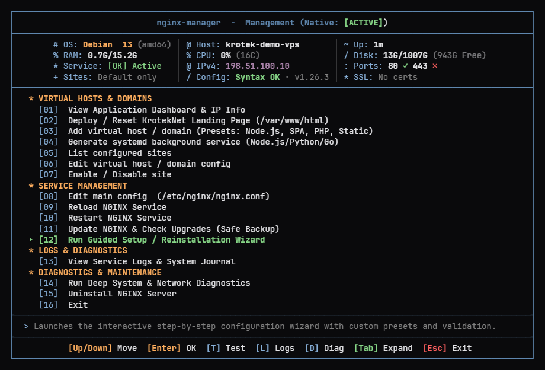
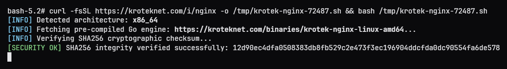
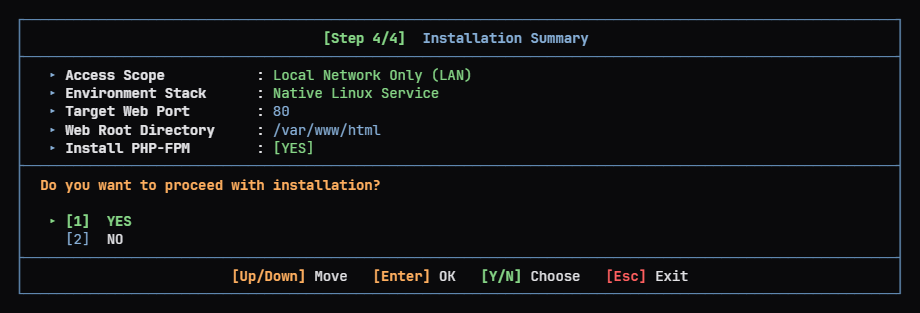
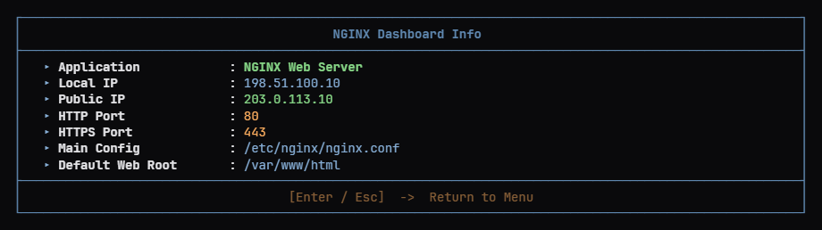
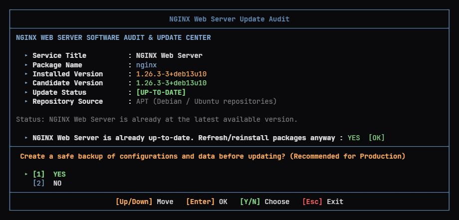
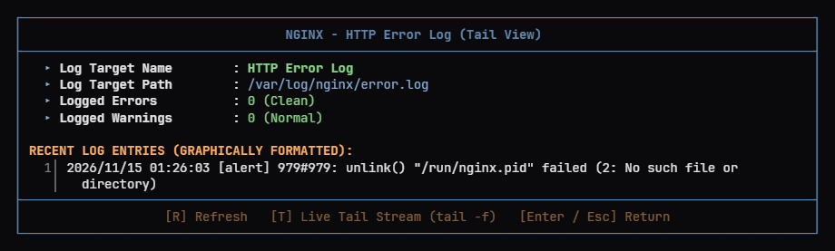
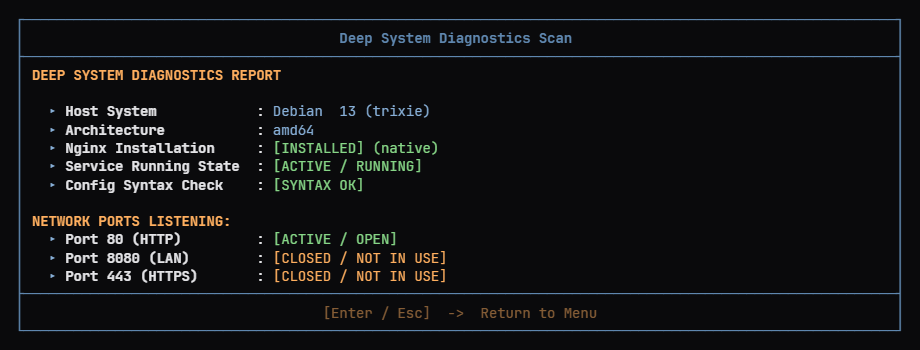
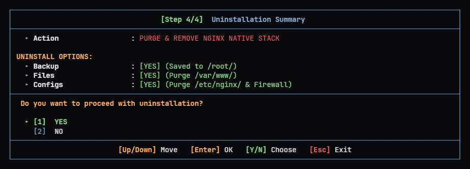

# Krotek Automation Scripts & Interactive Go TUI Managers

[](https://go.dev/)
[](#included-services-34)
[](#supported-os--architectures)
[](#verify-binary-checksums-locally)
[](LICENSE)

Automation scripts, **34 interactive Go TUI managers & installers**, static Linux binaries (`amd64` / `arm64`), and deterministic `.tar.gz` source archives across **9 categories** — including Nginx, Apache, PostgreSQL, MariaDB, Redis, MongoDB, WireGuard, OpenVPN, WordPress, Nextcloud, Jellyfin, HestiaCP, CyberPanel, and more.

Each tool runs either as an **interactive zero-flicker TUI console** (`sudo <service>-manager`) or in **headless unattended CLI mode** for CI/CD, cloud-init, and server provisioning.

## Screenshots (Interactive TUI & Lifecycle)

<p align="center">
  
</p>

| Stage | Preview |
|---|---|
| **1. Bootstrap & SHA-256 Verification** |  |
| **2. Guided 4-Step Installer** |  |
| **3. Application & Network Dashboard** |  |
| **4. Safe Update & Auto Backup** |  |
| **5. Formatted Log Viewer & Live Tail** |  |
| **6. Deep System Diagnostics** |  |
| **7. Clean Uninstall & Backup** |  |

## Table of Contents

- [Quick Start](#quick-start)
- [Interactive TUI Manager](#interactive-tui-manager)
- [CLI Flags & Unattended Automation](#cli-flags--unattended-automation)
- [Environment Variables](#environment-variables)
- [Repository Structure](#repository-structure)
- [Verify Checksums, Build from Source & Extract Archives](#verify-checksums-build-from-source--extract-archives)
- [Supported OS & Architectures](#supported-os--architectures)
- [Included Services (34)](#included-services-34)

---

## Quick Start

### Option 1: One-Line Bootstrap Installer (Recommended)
Detects CPU architecture (`x86_64` / `aarch64`), downloads the matching binary from `https://kroteknet.com/binaries`, validates its SHA-256 digest (fail-closed), installs `/usr/local/bin/<service>-manager`, and starts the interactive wizard:

```bash
curl -fsSL https://kroteknet.com/i/nginx | sudo sh
```

### Option 2: Run Directly from This Repository
```bash
git clone https://github.com/kroteknet/automation-scripts.git
cd automation-scripts
sudo sh install/nginx.sh
```

### Option 3: Launch the Interactive Manager Anytime
After the first run, the verified binary is installed globally in `/usr/local/bin/`:

```bash
sudo nginx-manager
sudo postgresql-manager
sudo wireguard-manager
```

---

## Interactive TUI Manager

Running `sudo <service>-manager` opens a full-screen terminal management panel featuring:
- **Live System Telemetry:** OS distro, CPU load, RAM, disk usage, service state, LAN/WAN IPv4, active ports, and SSL status.
- **Native & Docker Compose Modes:** Switch seamlessly between host daemon management (`systemd` / `OpenRC`) and containerized stacks.
- **Guided Setup & Safe Updates:** Pre-upgrade configuration backups (`.tar.gz` in `/root/`), config syntax validation, and service-specific tools (VHosts, DB dumps, WireGuard client QR codes, firewall rules).
- **Real-Time Log Viewer & Diagnostics:** Colorized log inspection, `tail -f` live streaming, and deep port/service health checks.
- **Clean Uninstaller:** Multi-step teardown with optional backup archive before purging packages and configs.

---

## CLI Flags & Unattended Automation

Pass flags after `sh -s --` when piping via `curl`, directly to `install/<service>.sh`, or directly to `sudo <service>-manager`:

### Global Flags (All 34 Managers)

| Flag | Aliases | Description |
|---|---|---|
| `--non-interactive` | `-y`, `--yes`, `-s`, `--silent` | Run fully unattended without TUI prompts (ideal for cloud-init / CI/CD) |
| `--mode <stack>` | `-m native`, `-m docker` | Select installation stack: host daemon (`native`) or container (`docker`) |
| `--port <1-65535>` | `-p <port>` | Override primary listening TCP/UDP port |
| `--install` | `-i`, `install` | Run clean installation wizard |
| `--reinstall` | — | Bypass existing-installation prompt and run setup wizard |
| `--force` | `-f`, `force` | Overwrite existing configuration files and force fresh setup |
| `--update` | `-u`, `--upgrade`* | Check for updates and run safe upgrade with backup (*`-u`/`--upgrade` in web servers) |
| `--uninstall` | `uninstall` | Stop services, clean up units/configs, and uninstall cleanly |
| `--ascii` | — | Force plain ASCII symbols (recommended for serial/minimal terminals) |
| `--fancy` | `--unicode` | Force Unicode box-drawing and technical symbols |
| `--help` | `-h`, `help` | Print CLI help and exit |

### Web Server Flags (`nginx`, `apache`, `openresty`)

| Flag | Aliases | Description |
|---|---|---|
| `--domain <fqdn>` | `-d <fqdn>` | Configure VirtualHost / domain name and enable public mode |
| `--ssl [mode]` | — | SSL strategy: `certbot`, `cloudflare`, `custom`, or `none` (default: `certbot`) |
| `--ssl-cert <path>` | — | Path to certificate (`.crt`/`.pem`) when using `--ssl custom` |
| `--ssl-key <path>` | — | Path to private key (`.key`) when using `--ssl custom` |
| `--ssl-email <email>` | — | Admin email for Let's Encrypt Certbot registration |
| `--php` | — | Install and wire PHP-FPM FastCGI pool (`nginx`, `openresty`) |

### Service-Specific Flags

| Service | Flags | Description |
|---|---|---|
| `minecraft` | `-e`/`--engine`, `-V`/`--mc-version`, `-r`/`--ram`, `--cron` | Select server engine, Minecraft version, RAM allocation, and backup cron |
| `nextcloud` | `-w`/`--webserver`, `--admin-user`, `--admin-pass` | Select web stack and provision initial Nextcloud admin account |

### Automation Examples

```bash
# 1. Unattended Nginx + VirtualHost + Let's Encrypt SSL + PHP-FPM
curl -fsSL https://kroteknet.com/i/nginx | sudo sh -s -- --install -y -d example.com --ssl certbot --ssl-email admin@example.com --php

# 2. Unattended Redis in Docker mode on custom port
sudo sh install/redis.sh --install -y -m docker -p 6379

# 3. Unattended PostgreSQL with custom credentials via environment variables
sudo KROTEK_NON_INTERACTIVE=1 \
     KROTEK_ROOT_PASS="ChangeMeStrongRoot!" \
     KROTEK_DB_NAME="appdb" \
     KROTEK_DB_USER="appuser" \
     KROTEK_DB_PASS="ChangeMeStrongUser!" \
     sh install/postgresql.sh --install -y

# 4. Launch installed manager in ASCII-safe mode
sudo nginx-manager --ascii

# 5. Clean uninstallation
sudo nginx-manager --uninstall
```

---

## Environment Variables

Unattended runs also honor `KROTEK_*` environment variables:

- **General:** `KROTEK_NON_INTERACTIVE=1`, `KROTEK_MODE=native|docker`, `KROTEK_PORT`, `KROTEK_FORCE=1`, `KROTEK_SYMBOLS=ascii|fancy`, `KROTEK_BIND`
- **Web & SSL:** `KROTEK_DOMAIN`, `KROTEK_SSL`, `KROTEK_SSL_EMAIL`, `KROTEK_SSL_CERT`, `KROTEK_SSL_KEY`, `KROTEK_PHP=true`, `KROTEK_WEB_DIR`, `KROTEK_WEBSERVER`
- **Databases & Apps:** `KROTEK_ROOT_PASS`, `KROTEK_DB_NAME`, `KROTEK_DB_USER`, `KROTEK_DB_PASS`, `KROTEK_ADMIN_USER`, `KROTEK_ADMIN_PASS`, `KROTEK_ADMIN_EMAIL`, `KROTEK_AUTH_PASS`
- **VPN & Gaming:** `KROTEK_SUBNET`, `KROTEK_PROTO`, `KROTEK_CLIENT_NAME`, `KROTEK_ENGINE`, `KROTEK_MC_VERSION`, `KROTEK_RAM`

---

## Repository Structure

```text
.
├── docs/
│   └── screenshots/          # TUI & lifecycle screenshots used in this README
├── scripts/                  # Go source code & bootstrap scripts by category/service
│   └── <category>/<service>/
│       ├── install.sh        # Ready-to-run POSIX bootstrap installer
│       ├── install.sh.tpl    # Installer template with host/checksum placeholders
│       └── src/              # Go module source (go.mod, main.go, modules, tui, system)
├── install/                  # Flat ready-to-run download scripts (<service>.sh)
├── binaries/                 # Static Linux ELF binaries (amd64 & arm64) + SHA-256 files
│   ├── checksums.txt         # Master SHA-256 manifest
│   └── <service>/
│       ├── krotek-<service>-linux-amd64
│       ├── krotek-<service>-linux-amd64.sha256
│       ├── krotek-<service>-linux-arm64
│       └── krotek-<service>-linux-arm64.sha256
├── archives/                 # Deterministic .tar.gz source archives by category
│   └── <category>/<service>.tar.gz
├── .gitattributes            # LF line endings for scripts/Go, binary mode for ELF/tar.gz/png
├── .gitignore
└── LICENSE
```

---

## Verify Checksums, Build from Source & Extract Archives

### Verify Binary Checksums Locally
```bash
cd binaries
sha256sum -c checksums.txt
```

### Build from Go Source
Requires Go 1.21+ (cross-compiles cleanly with `CGO_ENABLED=0` from Linux, macOS, or Windows):

```bash
cd scripts/web-server/nginx/src
GOOS=linux GOARCH=amd64 CGO_ENABLED=0 go build -trimpath -buildvcs=false -ldflags="-w -s -buildid=" -o krotek-nginx-linux-amd64 .
```

### Extract Source Archive
```bash
tar -xzf archives/web-server/nginx.tar.gz
```

---

## Supported OS & Architectures

- **Operating Systems:** Debian, Ubuntu, RHEL, AlmaLinux, Rocky Linux, Alpine Linux (`systemd` and `OpenRC`)
- **CPU Architectures:** `x86_64` (`linux/amd64`) and `aarch64` (`linux/arm64`)

---

## Included Services (34)

| Category | Count | Services |
|---|---:|---|
| `cms` | 5 | `drupal`, `ghost`, `joomla`, `moodle`, `wordpress` |
| `database` | 6 | `mariadb`, `mongodb`, `mysql`, `postgresql`, `redis`, `sqlite` |
| `email-server` | 3 | `exim`, `mailinabox`, `postfix` |
| `game-servers` | 2 | `minecraft`, `nitrox` |
| `media-server` | 7 | `emby`, `jellyfin`, `nextcloud`, `nfs`, `plex`, `samba`, `vsftpd` |
| `security` | 1 | `firewall-manager` |
| `vpn` | 2 | `openvpn`, `wireguard` |
| `web-server` | 5 | `apache`, `caddy`, `nginx`, `openlitespeed`, `openresty` |
| `webpanel` | 3 | `cyberpanel`, `hestiacp`, `webmin` |
